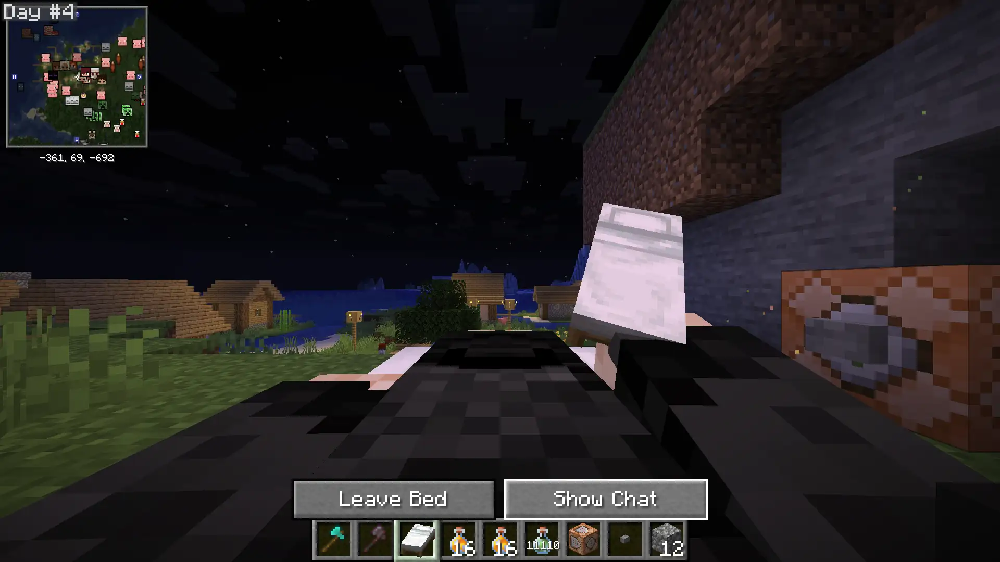
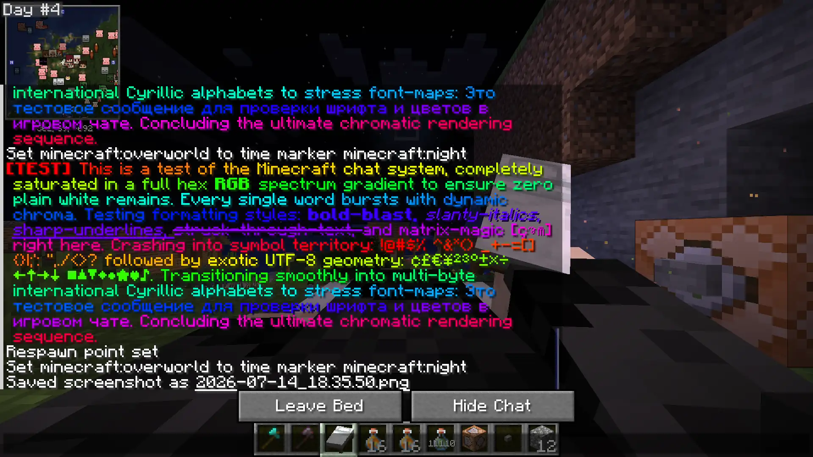
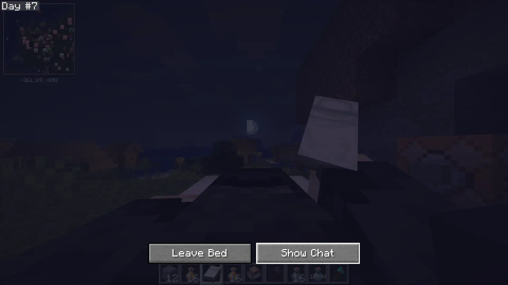
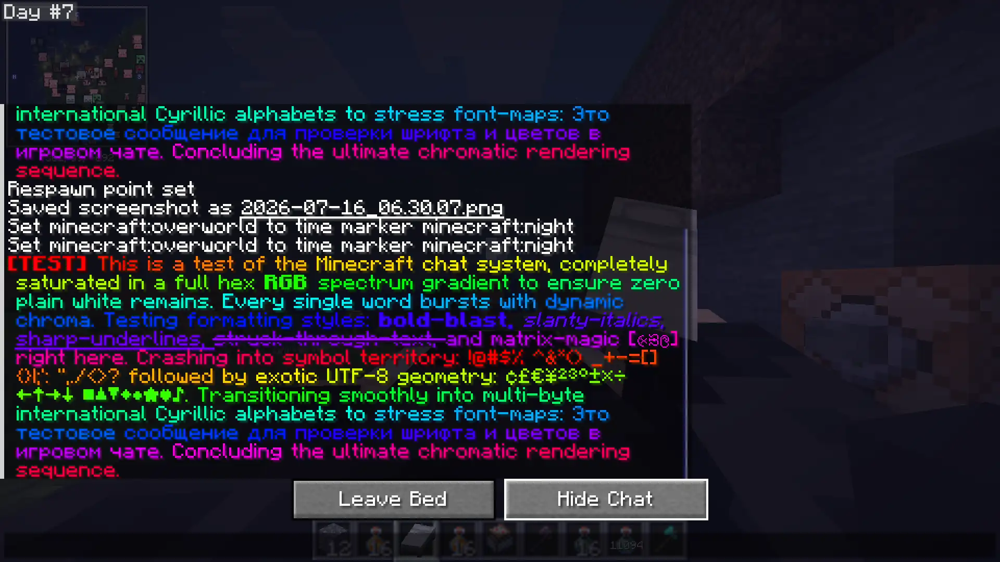

    
    
    
    
    
    

# 🛌 Vanilla Outsider: Bed Chat Hider

> **"A clean, distraction-free sleeping view with a single click."**

**1 Jar 1 Version Policy:** I build **1 dedicated JAR for each Minecraft version** (e.g. MC 26.3, MC 26.2, MC 26.1.2, 1.21.11, 1.21.1, 1.20.1). Please download the exact build that matches your Minecraft installation.

**Vanilla Outsider: Bed Chat Hider** is a lightweight, client-only Fabric mod that adds an intuitive "Hide Chat" / "Show Chat" toggle button next to the "Leave Bed" button while sleeping.

---

> [!NOTE]
> **Client-Side Sovereignty:** Unlike server-side mods in the Vanilla Outsider Collection, Bed Chat Hider is 100% client-side. You can safely install Bed Chat Hider on your client and join ANY vanilla, Fabric, Paper, Spigot, Purpur, or NeoForge/Forge server without needing the mod installed on the server!

---

## 🎥 Feature Showcase

    
     
    <em>Disclaimer: The showcase video above was recorded with my <strong>True Sleep</strong> companion mod installed.</em>

---

## ✨ Features

### 🎞️ Clear Sleeping View
Hides the chat input background fill, autocomplete suggestions, and chat history log completely when toggled with the button while resting.

#### With True Sleep Mod (Accelerated Time-Lapse View)
When paired with my **[True Sleep](https://modrinth.com/mod/vanilla-outsider-true-sleep)** companion mod, the dark sleep vignette is removed, allowing you to watch the sky fly by in real-time time-lapse without UI overlays blocking your view!

* **Chat Hidden (True Sleep)**:

* **Chat Shown (True Sleep)**:

#### Without True Sleep Mod (Vanilla Dark Sleep Overlay)
Without the True Sleep mod, the vanilla black vignette sleep darkening remains present, but the chat overlay is hidden.

* **Chat Hidden (Vanilla)**:

* **Chat Shown (Vanilla)**:

### 💤 Session-Based Preference
Tracks your toggle preference in-memory during your current play session so you do not have to keep toggling it every in-game night.

### 🛡️ Input Interception & Protection
Safely intercepts and blocks keyboard typing, mouse scrolling, and clicks on the invisible chat log when chat is hidden, ensuring that only standard UI buttons are interactive and `Escape` closes the bed screen normally.

---

## 🔧 Optional Configuration & Ergonomics

Bed Chat Hider is completely plug-and-play with zero setup required, but also includes optional in-game configuration through **ModMenu** and **YetAnotherConfigLib (YACL)** (powered by Dasik Library):

* **`suppress_sleep_vignette`** *(Default: `false`)*: Eliminates the dark sleeping vignette overlay when resting in a bed. *(Note: If companion mod **[True Sleep](https://modrinth.com/mod/vanilla-outsider-true-sleep)** is installed, True Sleep automatically manages sleep visuals and takes precedence cleanly without conflict).*
* **`auto_hide_chat`** *(Default: `false`)*: Automatically hides the chat overlay upon entering any bed.

Settings are saved locally to `.minecraft/config/bedchathider.json`. If ModMenu or YACL are not installed, the mod runs seamlessly with safe defaults with zero crash risk.

---

## ☕ Support the Development

If you enjoy the **Vanilla Outsider** collection, consider supporting my work!

> [!NOTE]
> **Indonesian Supporters:** SocioBuzz and Saweria support local payment methods (GoPay, OVO, Dana, QRIS, etc.) if you wish to support me locally without PayPal/Ko-fi!

---

## 📜 Credits & Permissions

| Role | Author |
| :--- | :--- |
| **Architect** | **Dasik (Rifaditya)** |
| **Collection** | Vanilla Outsider |
| **License** | GPLv3 |
| **Source Code** | [GitHub Repository](https://github.com/Rifaditya/Vanilla-Outsider-Bed-Chat-Hider) |
| **Issue Tracker** | [GitHub Issues](https://github.com/Rifaditya/Vanilla-Outsider-Bed-Chat-Hider/issues) |

> [!IMPORTANT]
> **Modpack Permissions:** You are fully welcome to include this mod in any modpack on any platform! However, the mod file must be downloaded directly through official distribution channels (**Modrinth** or **CurseForge**). Re-uploading, mirroring, or redistributing the original mod JAR to third-party mirror sites, scraper portals, or unauthorized launchers is strictly prohibited.

---

**Made with ❤️ for the Minecraft community**

*Part of the Vanilla Outsider Collection*

